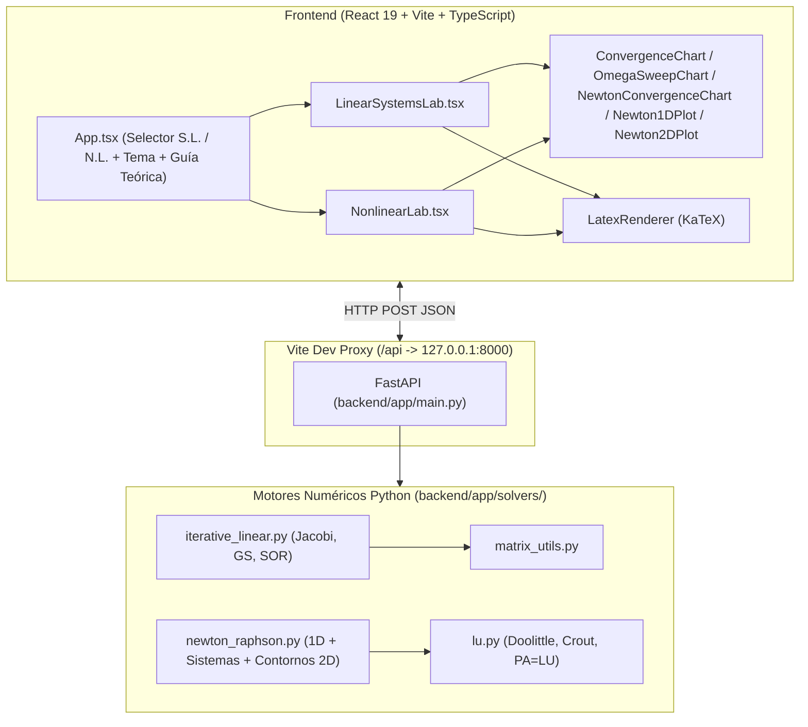

# ARCHITECTURE.md — Arquitectura Técnica y Contrato de API

## 1. Diagrama de Componentes



---

## 2. Contrato de Endpoints REST

### `GET /api/health`
Verifica disponibilidad del servicio. Respuesta: `{"status": "ok", "service": "numerilab-backend"}`.

### `POST /api/linear/analyze`
Ejecuta en una sola llamada el análisis completo del sistema lineal $Ax = b$:
- **Request (`LinearAnalyzeRequest`)**:
  ```json
  {
    "A": [[10, -1, 2], [-1, 11, -1], [2, -1, 10]],
    "b": [6, 25, -11],
    "x0": [0, 0, 0],
    "omega": 1.25,
    "tol": 1e-6,
    "max_iter": 100,
    "criterion": "abs_diff",
    "lu_strategy": "partial_pivot",
    "decimals": 6,
    "apply_rounding": false,
    "rounding_mode": "none"
  }
  ```
- **Response**:
  - `diagnostics`: dominancia diagonal por fila (con `reordering_suggestion` cuando exista una permutación que mejore la dominancia o elimine ceros diagonales) + `matrices` ($D, L, U, T_j, c_j, T_g, c_g, T_\omega, c_\omega$, normas y $\rho(T)$).
  - `lu`: solución directa con factores $P, L, U$, pasos de eliminación, sustituciones $Ly=Pb$ y $Ux=y$, residual, `operation_count` (FLOPs reales y cota teórica), `rounding_mode` y `finite_arithmetic_diff`. El campo `x_raw` conserva el vector usado para calcular el residual.
  - `jacobi`, `gauss_seidel`, `sor`: resultado iterativo completo con ecuaciones por paso, `operation_count` y `rounding_mode`. `rel_error` y `rel_error_pct` se devuelven como `null` si la métrica es indefinida o supera el rango numérico. Todos los métodos iterativos exponen `solution_raw` y pueden retornar `stagnated` si el redondeo o truncamiento fija el iterado con un residual fuera de tolerancia.
  - `verdict`: veredicto pedagógico automático comparando métodos convergentes en iteraciones, FLOPs y $\rho(T)$.

### `POST /api/linear/sor-sweep`
Ejecuta barrido de $\omega \in [0.10, 1.95]$ cada $0.05$:
- **Request (`SORSweepRequest`)**: `{ A, b, x0, tol, max_iter, criterion, decimals, apply_rounding, rounding_mode }`
- El barrido usa el mismo criterio de parada y modo de aritmética finita que el análisis. Los valores por defecto son diferencia absoluta, seis decimales y cálculo sin corte por paso (`rounding_mode = "none"`).
- **Response**: lista `points` (`omega`, `iterations`, `converged`, `spectral_radius`) + `optimal_omega` y `optimal_iterations`.

### `POST /api/nonlinear/newton-1d`
- **Request (`Newton1DRequest`)**: `{ expression, x0, tol, max_iter, decimals, criterion, apply_rounding, rounding_mode }` (`criterion`: `"residual_and_step"` | `"rel_diff"` | `"rel_pct"`; `0 < tol <= 1` salvo en `"rel_pct"` donde `0 < tol < 100`).
- **Response**: `f_latex`, `df_latex`, `d2f_latex`, `fourier_condition`, `convergence_warnings`, `rounding_mode`, `status`, `criterion`, `root`, `iterations`, `estimated_order`, `steps` (cada paso incluye `x_k`, `fx_k`, `dfx_k`, `d2fx_k`, `fx_next`, `x_next`, `abs_error`, `rel_error`, `rel_error_pct`, `step_latex`), `plot_bounds` y `sample_points`.

### `POST /api/nonlinear/newton-system`
- **Request (`NewtonSystemRequest`)**: `{ equations, variables, x0, tol, max_iter, decimals, criterion, apply_rounding, rounding_mode, bounds? }`.
- **Response**. Incluye `f_latex_list`, `jacobian_latex`, `estimated_order`, `rounding_mode`, `status`, `criterion`, `solution`, `iterations` y `steps`. Cada paso contiene `J_eval`, `F_eval`, `dx`, `abs_error`, `rel_error`, `rel_error_pct`, el Jacobiano evaluado y el vector $-F$ en LaTeX (`J_eval_latex`, `neg_F_latex`) y los factores $P, L, U$ en `lu_detail`. Para $n=2$ incluye `contour_2d` con `bounds`, `f1_segments` y `f2_segments`.

---

## 3. Decisiones Clave de Diseño
1. **Marching Squares en el servidor para $2\times 2$.** El servidor refina y verifica los cruces de signo antes de devolver segmentos para el gráfico. Una potencia entera positiva externa se representa a partir de su base para conservar sus ceros.
2. **Evaluación 1D dual (SymPy en backend + `mathjs` en frontend):** El backend analiza la expresión con una gramática matemática acotada y obtiene la derivada simbólica con SymPy. `mathjs` usa la expresión aceptada por el servidor para que Mafs pueda volver a muestrear la curva al hacer zoom o desplazar el plano.
3. **Protección numérica.** La API rechaza entradas no finitas. Los métodos interrumpen los cálculos cuando el iterado, el error o el residual exceden el rango representable. Las ventanas automáticas de Newton abarcan los iterados de magnitud hasta $10^{15}$. Las tablas muestran también los pasos que quedan fuera del plano.
4. **Convergencia de Newton.** En el criterio por defecto (`residual_and_step`), si el residual se evalúa como cero se verifica con mayor precisión para detectar subdesbordamiento, y para residual no nulo se comprueban las tolerancias del residual y de la corrección de Newton (con margen de cuatro unidades de precisión a la escala del iterado), incluido el punto inicial. Alternativamente, `rel_diff` y `rel_pct` evalúan el error relativo aproximado o porcentual ($\le \text{tol}$). Si el iterado se repite sin cumplir la condición de parada, se informa `stagnated`.
